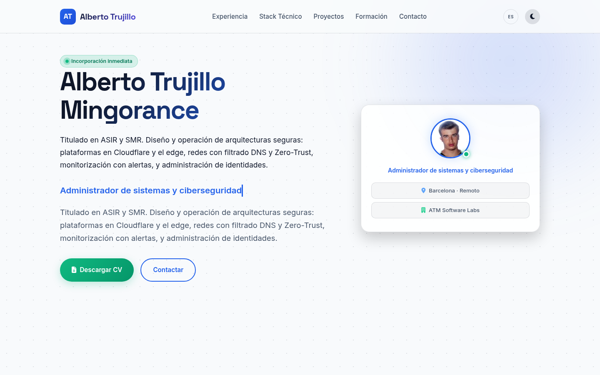
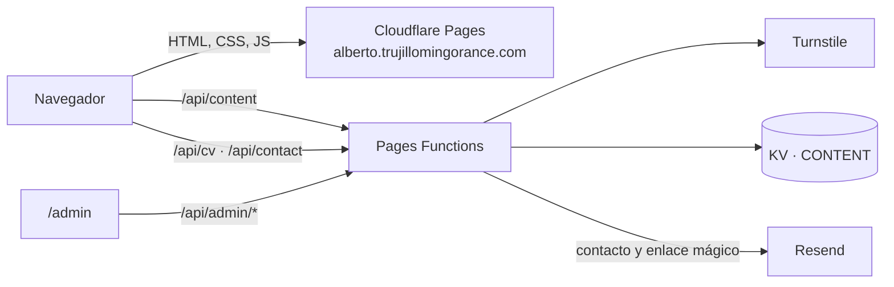

<p align="center">
  
</p>

<p align="center">
  <strong>Web personal de Alberto Trujillo Mingorance, técnico de sistemas en Barcelona: experiencia, stack, proyectos, formación y CV en PDF.</strong><br/>
  <em>Personal portfolio with an interactive terminal, on-demand PDF CV and a private content editor.</em>
</p>

<p align="center">
  <a href="https://alberto.trujillomingorance.com"><b>alberto.trujillomingorance.com</b></a> ·
  <a href="https://trujillomingorance.com">trujillomingorance.com</a> ·
  <a href="LICENSE">Todos los derechos reservados</a>
</p>

<p align="center">
  
  
  
</p>

---

## Capturas

<p align="center"></p>

## Funciones

- **Secciones:** presentación, disponibilidad, experiencia, stack, proyectos con filtros, formación y contacto.
- **Terminal interactiva:** comandos sencillos para recorrer el perfil desde el teclado, con historial.
- **CV en PDF bajo demanda:** `POST /api/cv` genera el PDF en el servidor a partir del contenido publicado, tras pasar Cloudflare Turnstile.
- **Formulario de contacto** con Turnstile, campo trampa y límite por IP. El mensaje llega por correo con Resend.
- **Editor privado** (`/admin`): acceso con enlace mágico enviado al correo del propietario (20 minutos, un solo uso). El contenido se guarda en Workers KV y la web lo lee en `/api/content`.
- **Enlace «Panel interno»** para cuentas internas de Microsoft Entra ID, común a todas las webs de trujillomingorance.com.
- **Ligera:** fuentes autoalojadas (Inter, JetBrains Mono, Space Grotesk) y subconjuntos de iconos.

## Stack

| Capa | Tecnología |
|---|---|
| Frontend | HTML, JavaScript (módulos ES) y Tailwind CSS 4, compilados con Vite |
| Hosting | **Cloudflare Pages** (`dist/`) |
| API | **Pages Functions** (`functions/api/*`) |
| Datos | **Workers KV** (`CONTENT`) |
| Anti-bots | **Cloudflare Turnstile** |
| Email | **Resend** |

## Arquitectura



| Ruta | Qué hace |
|---|---|
| `GET /api/content` | Contenido publicado (secciones del portfolio) |
| `POST /api/cv` | PDF del CV (Turnstile + límite por IP) |
| `POST /api/contact` | Mensaje de contacto (Turnstile + límite por IP) |
| `/api/admin/login`, `/session`, `/content` | Editor privado con enlace mágico |

## Seguridad

- **Sin contraseña en el editor:** enlace mágico de 20 minutos guardado en KV; la sesión va en cookie firmada.
- **Turnstile** en CV, contacto y acceso al editor, más límites por IP.
- **Cabeceras** definidas en `public/_headers` (CSP, HSTS, `nosniff`, `X-Frame-Options`).
- **Build sin source maps** y minificado con Terser.

## Desarrollo local

Requisitos: **Node.js ≥ 20**.

```bash
git clone https://github.com/ATM-Software-Labs/portfolio.git && cd portfolio
npm install
npm run dev            # Vite en http://localhost:5173 (solo frontend)
npm run build          # genera dist/
npx wrangler pages dev dist   # frontend + Functions en http://localhost:8788
```

## Despliegue

El proyecto de Cloudflare Pages `alberto-portfolio` está conectado a GitHub: cada push a `main` compila con Vite y publica en `alberto.trujillomingorance.com`. También se puede publicar a mano con `npm run deploy`.

### Variables y bindings (solo nombres)

| Nombre | Tipo | Uso |
|---|---|---|
| `CONTENT` | binding KV | Contenido del portfolio y enlaces de acceso |
| `ADMIN_SESSION_SECRET` | secreto | Firma de la sesión del editor |
| `TURNSTILE_SECRET` | secreto | Verificación de Turnstile |
| `RESEND_API_KEY` | secreto | Envío de correos |
| `EMAIL_FROM` | variable | Remitente de los correos |
| `MAIL_KEY` | secreto, opcional | Nombre alternativo de `RESEND_API_KEY` en el formulario de contacto |

## Estructura

```
index.html, admin.html  entradas de Vite
src/js/                 app, terminal, CV, contenido, editor, Turnstile
src/css/                estilos, fuentes e iconos
functions/api/          content, cv, contact, admin/
functions/lib/          auth, Turnstile, modelo de contenido, PDF del CV
public/                 _headers, fuentes, imágenes, favicons, atm-internal.js
docs/                   banner y capturas
```

## Licencia

Todos los derechos reservados © 2026 Alberto Trujillo Mingorance. Consulta [LICENSE](LICENSE): el código y el contenido se publican solo para su consulta.

<p align="center"><sub>© 2026 ATM Software Labs · <a href="https://trujillomingorance.com">trujillomingorance.com</a></sub></p>
